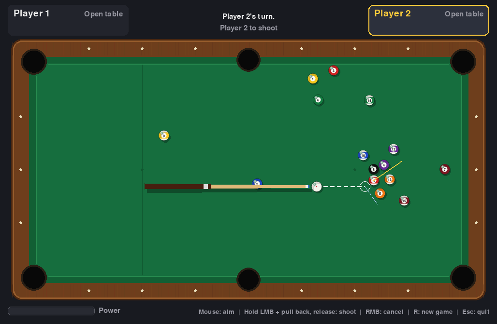

# Pool – 8-Ball in Pygame with hand-written Verlet physics

A complete pool / billiards game (simplified 8-ball, 2 players, hot seat) written in
Python with **pygame**. **No physics library** is used – the whole simulation
(integration, collisions, friction, pockets) is implemented from scratch in
[`pool/physics.py`](pool/physics.py).



## Running the game

```bash
pip install -r requirements.txt
python main.py
```

Requires Python 3.9+.

Run the tests:

```bash
python -m pytest
```

## Controls

| Input | Action |
|-------|--------|
| Move mouse | Aim (the cue ball points towards the mouse) |
| Hold left mouse button and pull back | Set power (power bar bottom left) |
| Release left mouse button | Shoot |
| Right mouse button (while charging) | Cancel the shot |
| Left click (ball in hand) | Place the cue ball |
| `R` | New game |
| `Esc` | Quit |

While aiming, a guide line shows the cue ball path, a ghost ball at the
contact point, the direction the object ball will travel (yellow) and the
deflection of the cue ball (blue).

## Rules (simplified 8-ball)

* Player 1 breaks. The table stays *open* after the break.
* The first player to legally pocket a ball after the break gets that group
  (solids 1–7 or stripes 9–15); the opponent gets the other group.
* Pocketing one of your own balls lets you shoot again; otherwise the turn passes.
* **Fouls** → the opponent gets **ball in hand** (may place the cue ball anywhere):
  * the cue ball is pocketed (scratch),
  * no ball is hit,
  * the first ball hit is not one of your own (or not the 8-ball once your group is cleared),
  * the 8-ball is hit first on an open table.
* **8-ball:** pocketing it after clearing your group (without a foul) wins.
  Pocketing it too early or together with a foul loses. An 8-ball pocketed on
  the break is re-spotted.

## Physics: Verlet integration

Every ball stores only its **current position** `x` and its **position from the
previous sub-step** `x_prev`. The velocity is implicit:

```
v = (x - x_prev) / h
```

One frame of the simulation uses a **fixed time step** (`1/120 s`) split into
**4 sub-steps** (`h = 1/480 s`), which keeps the simulation deterministic and
prevents fast balls from tunnelling through each other. Each sub-step does:

1. **Integration (position Verlet with damping)**

   ```
   x_next = x + (x - x_prev) * exp(-k*h) + a * h²
   ```

   * `a = -μ · v/|v|` is the constant rolling-friction deceleration
     (`μ = 110 px/s²`).
   * `exp(-k*h)` models speed-proportional losses (`k = 0.3 1/s`).
   * If the speed drops below a **stop threshold** (`4 px/s`) – or friction would
     reverse the motion in this step – the ball is put to rest (`x_prev = x`).

2. **Ball–ball collisions** (all balls have equal mass)
   * *Positional correction:* overlapping balls are pushed apart along the
     contact normal. `x` and `x_prev` are shifted together, so the implicit
     velocity is not changed.
   * *Impulse:* with normal `n` and relative velocity `v_rel = (v_a - v_b)·n`
     (only when the balls approach each other):

     ```
     j   = (1 + e) · v_rel / (1/m_a + 1/m_b)
     v_a' = v_a - j/m_a · n
     v_b' = v_b + j/m_b · n
     ```

     with restitution `e = 0.95`. In Verlet form a new velocity is applied by
     rewriting the previous position: `x_prev = x - v'·h`.

3. **Cushion collisions:** cushions are line segments with gaps at the pocket
   mouths. The closest point on the segment yields the normal; the ball is
   pushed out of the cushion and the normal velocity component is reflected and
   damped: `v' = v - (1 + e_c)(v·n) n` with `e_c = 0.78`. Segment endpoints act
   as rounded pocket jaws.

4. **Pockets:** a ball whose centre enters a pocket circle (or crosses a cushion
   line through a pocket mouth) is pocketed.

A shot is over when all balls are at rest; the rules engine then evaluates
the events of the shot (first ball hit, pocketed balls, scratch).

## Project structure

```
main.py              entry point
pool/physics.py      Vec2, Ball, Verlet integration, collisions, pockets
pool/table.py        table geometry, cushions, pockets, rack
pool/rules.py        simplified 8-ball rules (pure logic, testable)
pool/render.py       drawing with pygame primitives (table, balls, cue, HUD)
pool/game.py         game state machine, input, aim guide, main loop
tests/               pytest tests for physics, rules and a headless smoke test
```

## Tests

* free motion without friction is exact
* head-on elastic collision swaps velocities
* momentum conservation (and no energy gain) in oblique collisions
* overlap resolution
* cushion bounce with restitution
* friction slows the ball monotonically and brings it to rest
* pocket detection
* full break shot on the real table settles with all balls inside the table
* rules: scratch/ball in hand, group assignment, wrong ball first, winning/losing on the 8
* headless smoke test of the whole game (`SDL_VIDEODRIVER=dummy`)
